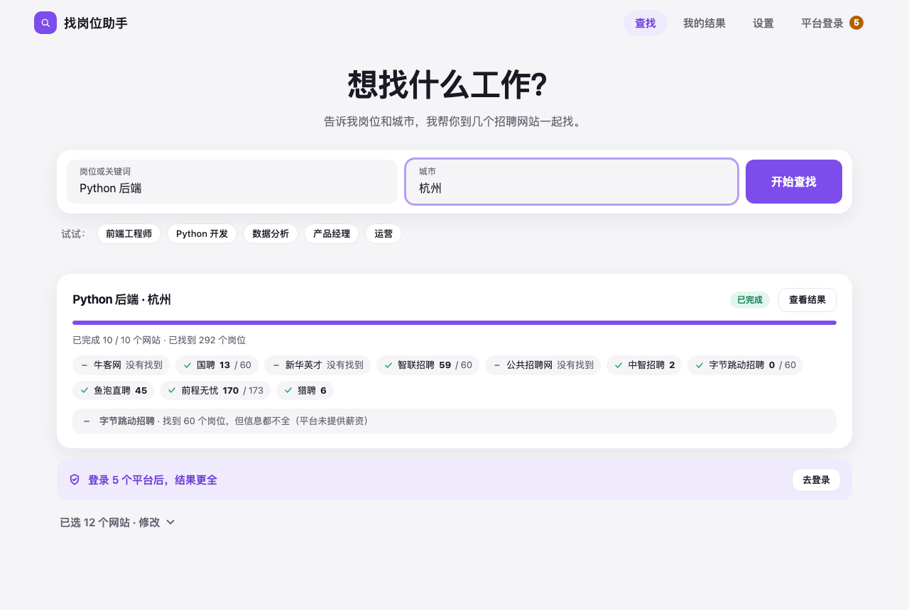
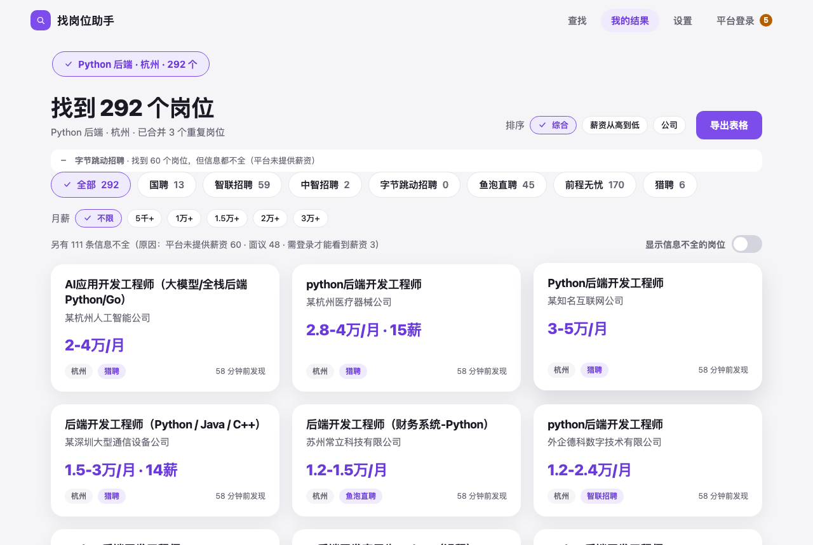
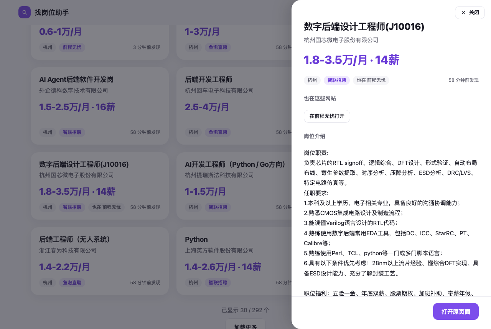
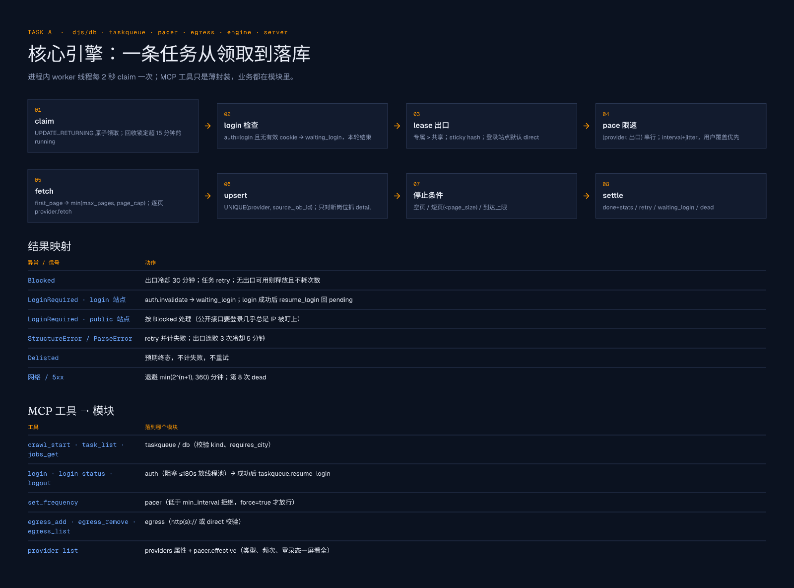

# dear-job-seeker

A **local job-search client** for Chinese job sites that speaks MCP. One program on your own machine searches 14 job sites at once, keeps every job in a local SQLite file and gives you two ways to use it:

- **Desktop app (找岗位助手)** — a small native window for people who never touch a terminal. No local web server, no open port.
- **MCP server (stdio)** — plug it into any MCP-capable AI client and ask for jobs in plain language.

> 中文简介：在你自己电脑上运行的找岗位工具，一次查 14 个招聘网站。可以直接打开桌面窗口用，也可以让 AI 助手通过 MCP 调用。每个岗位都整理成同一套信息：职位、公司、城市、数字薪资范围和职位描述；同一个岗位出现在几个网站上时合并成一条。需要登录的网站用你自己的账号在本机登录（扫码或密码），登录信息只保存在本机。

| Search | Results |
|---|---|
|  |  |
| **One job on two sites** | **Platform logins** |
|  |  |

## Download

Every [release](https://github.com/daijinma/dear-job-seeker/releases/latest) has three ready-to-run builds with Python and all libraries inside, so there is nothing to install:

| Your computer | File |
|---|---|
| Mac with Apple silicon (M1 or later) | `dear-job-seeker-<version>-macos-arm64.zip` |
| Mac with an Intel chip | `dear-job-seeker-<version>-macos-x86_64.zip` |
| Windows 10 / 11, 64-bit | `dear-job-seeker-<version>-windows-x64.zip` |

Unzip it and double-click **找岗位助手** (`找岗位助手.app` on a Mac, `找岗位助手.exe` in the unzipped folder on Windows). The same download holds the command-line program `djs` for AI clients and scripts; it uses the same data as the window.

**First launch.** The builds are not code-signed, so the system asks once whether to trust them.

- **macOS** — "cannot be opened because Apple cannot check it for malicious software". Right-click the app, choose *Open*, then *Open* again. On macOS 15 and later that shortcut is gone: open System Settings → Privacy & Security, scroll to the message about the app and click *Open Anyway*. Or run `xattr -dr com.apple.quarantine "找岗位助手.app"` once in Terminal.
- **Windows** — SmartScreen shows "Windows protected your PC": click *More info*, then *Run anyway*. The window needs Microsoft's WebView2 runtime, which comes with Windows 11 and current Windows 10 updates.

**Browser.** Login windows and BOSS 直聘 use Google Chrome or Microsoft Edge when one is installed. With neither, run `djs install-browser` once: it downloads Chromium (several hundred MB).

## Quick start (from source)

```bash
git clone https://github.com/daijinma/dear-job-seeker.git && cd dear-job-seeker
python3 -m venv .venv
.venv/bin/pip install -e '.[ui]'            # '.[dev,ui]' to also run the tests
.venv/bin/djs ui                            # the desktop app
```

Login windows and BOSS 直聘 need a browser: an installed Chrome or Edge is used; with neither, run `.venv/bin/playwright install chromium` once.

## Use it from an AI client (MCP)

The MCP server is the `djs` program over stdio. Pick one way to register it:

| Where | MCP config |
|---|---|
| The download | `{"mcpServers": {"dear-job-seeker": {"command": "/Applications/找岗位助手.app/Contents/MacOS/djs"}}}` (Windows: `C:\path\to\dear-job-seeker\djs.exe`) |
| Nothing installed (needs [uv](https://docs.astral.sh/uv/)) | `{"mcpServers": {"dear-job-seeker": {"command": "uvx", "args": ["--from", "git+https://github.com/daijinma/dear-job-seeker", "djs"]}}}` |
| A clone of this repo | nothing to do: the committed [`.mcp.json`](.mcp.json) runs `uv run djs` from the repo root |
| Your own virtualenv | `{"mcpServers": {"dear-job-seeker": {"command": "/abs/path/to/.venv/bin/djs"}}}` |

The server tells the client the intended flow:

1. `search(keyword, city)` starts the search on every platform usable right now and returns at once.
2. `wait_for_search(keyword, city)` blocks until every platform is done and reports each one: `found`, `no_results`, `failed`, `waiting_login` or `running`.
3. `jobs_get(keyword, city, title="Python 后端", min_month_salary=15000, text="Django")` reads short summaries of complete jobs, each job once, filtered in the database (`title`: words of the role, in the job title; `text`: skills anywhere in the title or description).
4. `job_detail(job_id)` returns the full description of the few jobs worth reading.

When results look wrong or a search does not move, `status()` says why. Then ask, for example: *"杭州的 Python 后端，月薪 1.5 万以上，挑 5 个最合适的"*. Keys for the key-signed platforms go in the client's `env` block or in `$DJS_HOME/.env` (see below). Verified end to end with a headless MCP host on 2026-10-11.

## Platforms

Each platform declares its own type and pacing; nothing is global.

| Platform | name | login | city | interval (floor) | page cap | needs |
|---|---|---|---|---|---|---|
| 牛客网 | `nowcoder` | — | optional | 0.6 s (0.3 s) | — | — |
| 国聘 | `iguopin` | — | optional | 3 s (1 s) | 20 | — |
| 新华英才 | `chinahr` | — | optional | 0.8 s (0.5 s) | — | — |
| 智联招聘 | `zhaopin` | optional | optional | 3 s (1.5 s) | 3 | — |
| 公共招聘网 | `mohrss` | — | optional | 1 s (0.5 s) | — | — |
| 中智招聘 | `ciic` | — | optional | 3 s (1.5 s) | 20 | — |
| 字节跳动招聘 | `bytedance` | — | optional | 0.8 s (0.4 s) | — | — |
| 鱼泡直聘 | `yupao` | — | optional | 3 s (1.5 s) | 34 | `DJS_YUPAO_NONCE_KEY`, `DJS_YUPAO_SIGN_SALT` |
| 前程无忧 | `job51` | optional | optional | 3 s (1.5 s) | 20 | `DJS_JOB51_HMAC_KEY` |
| 58同城 | `job58` | — | **required** | 1.5 s (0.75 s) | — | `DJS_JOB58_LUNA_SALT` |
| 赶集网 | `ganji` | — | **required** | 1.5 s (0.75 s) | 1 | — |
| 猎聘 | `liepin` | optional | optional (filtered locally) | 4 s (2 s) | 2 | — |
| BOSS 直聘 | `boss` | optional | optional | 8 s (6 s) | 5 | a browser window |
| 康强医疗网 | `kq36` | **required** | optional | 2.5 s (1 s) | — | a login |

- **login** — `optional`: works without an account and gives more with one (see [Logins](#logins)); **required**: no search before you log in.
- **city** — the city goes to the site's own search; 猎聘's API takes none, so its results are filtered by city here. A city typed as "杭州市西湖区" or "浙江杭州" counts as 杭州. A platform that has no code for the city (58同城 and 赶集 cover fewer cities; county-level cities such as 义乌 are known to few sites) is skipped and the search says so.
- **interval (floor)** — default seconds between two requests of that platform, and the lowest value `set_frequency` accepts without `force=true`.
- **Default selection** — the desktop app and the MCP `search` tool use every platform that needs nothing from you: no required login, no browser window, its keys set, and the city covered. BOSS 直聘 (opens a window) and 康强医疗网 (login first) are used when you pick them.
- Verified against the live sites on 2026-10-11. Fixtures in `tests/` are synthetic; layouts and field names can change without notice. 实习僧 (shixiseng) is intentionally not included: its data needs a JavaScript evaluator.

### Platforms that need keys

鱼泡, 前程无忧 and 58同城 sign their requests with material taken from their own mini-programs. **No key is shipped in this repository.** Supply them yourself as environment variables; a platform without its variables shows as "not configured" and is skipped.

```bash
# $DJS_HOME/.env  (default ~/.dear-job-seeker/.env; see .env.example; never commit it)
DJS_YUPAO_NONCE_KEY=...
DJS_YUPAO_SIGN_SALT=...
DJS_JOB51_HMAC_KEY=...
DJS_JOB58_LUNA_SALT=...
```

**`.env` autoload.** The MCP server, the desktop app and the CLI read `$DJS_HOME/.env` and then `./.env` at start (`KEY=VALUE` lines, `#` comments, optional quotes, empty values skipped). A variable that is already set (shell, your MCP client's `env` block, or the first file) is never overridden, and values are never logged. This is what gives a desktop app started from Finder, which has no shell environment, its keys. Obtaining and using such keys is your own responsibility and may violate the platforms' terms.

## Logins

Five platforms have a login. It is optional on four of them; the login gives more:

| Platform | How you log in | What the login adds |
|---|---|---|
| BOSS 直聘 | scan the QR code with the BOSS app | salaries: without a login BOSS shows every field but the pay, so its jobs stay incomplete |
| 智联招聘 | scan with WeChat | the desktop-site search, which returns a different set of jobs, not more of them (measured: 60 vs 60, 21 shared) |
| 前程无忧 | account and password | nothing measurable yet: the anonymous search is already complete, and the desktop-site search stayed blocked when logged in, so the login does not change how it searches |
| 猎聘 | scan with the 猎聘 app | possibly more jobs (not yet verified with a real account) |
| 康强医疗网 | account and password, or SMS code | searching at all: the site lists nothing without a login |

Click **去登录** in the app (page 平台登录) or call the `login` tool: an ordinary Chrome or Edge window opens on the site's own login page, you log in as you always do, and the window closes by itself once the login is detected. Nothing automates that window (BOSS 直聘 and 猎聘 blank any page an automation tool drives); the program only asks the browser for its cookies. The session is saved on your machine only (file mode 0600) with its expiry (7 days; 前程无忧 30), and searches that were waiting for it continue. `login_check` asks the site whether a saved login still works; the app runs the same check at start and marks dead logins as expired.

**BOSS 直聘** answers plain HTTP and headless browsers with `code 37` ("environment abnormal"), so it runs in a real browser window, which is why it is not preselected. It is paced at 8 s per request: its risk control can restrict an account and an IP for hours. `code 37` is treated as a temporary block (cooldown and retry), never as an expired login.

## MCP tools

| Tool | Purpose |
|---|---|
| `status()` | what is going on, in one call and without network: version, data folder, workers and the task each platform runs now (pages, details done / total), the queue by status, the browser a login window would use, open login windows, profiles in use, every login's state and end, missing keys (names only), cooling-down exits and each platform's latest problem in plain words. The first call when results look wrong |
| `search(keyword, city?, providers?, max_pages=1)` | start a search on every platform usable right now (or on `providers`); returns at once with the task ids, and in `skipped` the platforms that could not take it and why (a city they do not cover, keys missing); the search fails only when no platform can take it |
| `wait_for_search(keyword, city?, timeout=120)` | block until the search is done (one call waits at most 600 s, then answers `timed_out: true`): per platform the outcome, job counts and `completing {done, total}` while job details are still being fetched |
| `jobs_get(keyword?, city?, task_id?, provider?, min_month_salary?, max_month_salary?, title?, text?, complete_only=true, dedupe=true, fields="summary", limit=20, offset=0)` | stored jobs as `{jobs, total, returned, next_offset}`, newest first. From a search (keyword + city), a task and/or a platform. Filters run in SQL: pay per month overlapping the range, every word of `title` in the job title, every word of `text` in the title or description, the job's city. `summary` rows carry a 120-character `description_snippet` (20 jobs ≈ 16 KB; `full` ≈ 41 KB). Complete jobs only and each job once by default: `also_on` names the other platforms carrying it; incomplete jobs (`complete_only=false`) say what is `missing` and why |
| `job_detail(job_id)` | full text of one stored job: fetched once with the platform's own pacing and exit, its fields derived again from it, then served from the database |
| `search_list(limit=20)` | recent searches (same keyword + city = one search): status, `whole` (complete jobs, each job once: the number the app shows), and per platform the outcome, complete / incomplete jobs and the last error |
| `crawl_start(provider, keyword, city?, max_pages?, detail="auto")` | one crawl task on one platform. `detail`: `auto` fetches a job's detail page only while the job lacks a required element and the detail can supply it, `always` for every job without one, `never` keeps the list items only (one request per page) |
| `task_list(status?, limit=20)` | tasks with their stats (pages, new / seen jobs, details, complete / incomplete) and outcome |
| `provider_list()` | every platform: label, login, city rule, effective interval / jitter / max pages, floor, page cap, keys and browser state |
| `login(provider)` | open the platform's login page in a browser window (blocks up to 180 s) and save the session once it is detected |
| `login_status(provider?)` / `login_check(provider?)` / `logout(provider)` | saved login state (`logged_in` / `expired` / `not_logged_in`, saved and expiry times, how to log in, what it adds); ask the site whether a saved login still works; delete a saved login |
| `set_frequency(provider, interval?, jitter?, max_pages?, force?)` | per-platform override; below the floor needs `force=true` |
| `set_transport(provider, transport?)` | `http` or `browser` for a platform that supports both; omit to go back to its default |
| `egress_add(url, provider="*")` / `egress_remove(url)` / `egress_list()` | proxy pool (`direct` or `http(s)://…`; passwords are masked in output) |

Errors come back as `{"error": "..."}`; tools never raise.

## Data completeness

A stored job is final only when none of its required elements is missing.

| Element | Columns | Rule |
|---|---|---|
| position | `title` | non-empty |
| company | `company` | non-empty |
| city | `city` (+ `district` when known) | non-empty |
| salary | `salary_min`, `salary_max`, `salary_unit`, `salary_months` | two whole numbers, never text. `salary_unit` is `元/月`, `元/天`, `元/时` or `元/年`; `salary_months` the paid months when stated (`·14薪` → 14, never multiplied in). Taken from a platform's numeric fields where it states the unit, otherwise parsed from its salary text (`15-25K·14薪`, `1-1.5万`, `8千-1.8万`, `20-30万/年`, `200-400元/天`, `100元/时`). 面议 has no numbers, so the job stays incomplete |
| JD | `description` | plain text (HTML tags stripped, line breaks kept) |

- **Pay per month.** `salary_month_min` / `salary_month_max` hold every range as 元/月 (a day × 21.75, an hour × 174, a year ÷ 12), so jobs compare across sites and units. Salary filters and salary order use them.
- **One job on several sites.** Company (legal-form words and bracketed places removed), title (tags like 【14-16薪】 removed) and city make a `fingerprint`. Reading jobs shows each fingerprint once, as its best record (complete first, then more fields filled, then newest), with `also_on` listing the others. Two postings with the same title on one site stay separate.
- **How records get completed.** A crawl stores the list pages first, so results appear at once, then requests a detail page for each job that still lacks a required element, when that detail can supply it (an anonymous BOSS detail has no salary either, so it is not requested). Every job carries `missing`, `complete` and, in tool output, an `incomplete_reason`: `面议`, `需登录才能看到薪资`, `正在补全详情`, `详情获取失败` or `平台未提供…`.
- **What the sites do not publish** (those jobs stay incomplete and say why): 字节跳动招聘 gives no salary at all; BOSS hides it until you log in; 国聘, 新华英才, 58同城 and 赶集 word some salaries as 面议. 公共招聘网 publishes education and experience only as opaque codes, which are not mapped.

Stored when the site has them, not required: `education`, `experience`, `salary_text` (as the site words it), `source_url`, `published_at`.

## How it works



- **Queue** — SQLite tasks, claimed atomically; `pending → running → done | retry (backoff) | dead after 8 | waiting_login`. One worker thread **per platform** runs inside the process, so platforms never queue behind each other; unfinished tasks continue on the next start.
- **Frequency** — effective value = your override, else the platform default, never below its floor unless forced. Spacing is enforced per *(platform, exit)* across threads and processes before every request.
- **Capture** — `http` (plain requests) or `browser` (a page of a real Chromium with its own persistent profile, shared with the login window, so login and crawling share cookies). Set `DJS_CDP_URL=http://127.0.0.1:9222` to use a tab of your own Chrome instead (start it with `--remote-debugging-port=9222 --user-data-dir=<an empty folder>`); `DJS_BROWSER_HEADLESS=0|1` overrides whether the browser shows a window.
- **Egress** — a platform-specific proxy beats the shared pool; the exit is sticky per task; blocked exits cool down 30 min (3 consecutive failures: 5 min). An empty pool means direct. Login platforms use direct unless you add a dedicated proxy for them (a foreign IP with your personal session is more likely to be flagged).
- **Dedupe** — `UNIQUE(provider, source_job_id)` per platform; re-crawls update `last_seen_at`. The `task_jobs` table links every task to every job it saw, so repeating a search shows its results even though the jobs were found earlier. Across platforms, the fingerprint above.
- Design docs: [`docs/plan/v1.2.0/`](docs/plan/v1.2.0/) (requirements, decisions and findings from real use), [`docs/plan/v1.1.0/prd.md`](docs/plan/v1.1.0/prd.md), [`docs/architecture.drawio`](docs/architecture.drawio), UI and logic mockups in [`docs/design/`](docs/design/).

## CLI

For scripts, cron and agents that do not speak MCP. Both commands load `.env` like the server does.

| Command | What it does |
|---|---|
| `djs call <tool> ['<json args>']` | run any MCP tool by name, print its JSON result on stdout; errors are `{"error": "..."}` with exit code 1 (an unknown tool lists the available ones) |
| `djs work [--until-idle] [--timeout SEC]` | run the per-platform workers in the foreground and print one line per finished task (`task 3 nowcoder done pages=1 new=20 seen=0`). `--until-idle` exits once nothing is queued or running (tasks waiting for a login do not count; a failing task is retried with growing back-off, so pair it with `--timeout`); `--timeout` stops after SEC seconds (exit 2 if `--until-idle` was not reached) |

```bash
djs call search '{"keyword":"Python 后端","city":"杭州"}' \
  && djs work --until-idle --timeout 600 \
  && djs call jobs_get '{"keyword":"Python 后端","city":"杭州","min_month_salary":15000,"limit":5}'
djs call job_detail '{"job_id":7}'      # full text on demand
djs call search_list
```

`djs` with no arguments is the stdio MCP server and `djs ui` the desktop app; both run the workers themselves. `djs call` only reads and writes the database, so queued tasks wait until some process runs the workers: the MCP server, the desktop app or `djs work`.

## Desktop app

`djs ui` (or 找岗位助手 from the download) opens a native window (pywebview). The page talks to Python through an in-process bridge — there is no HTTP server and nothing listens on a port.

- **查找** — keyword and city; the newest search sits right under the box with each site's progress and what went wrong in plain words. The sites that need nothing from you are already picked (the city-only sites join when a city is filled in); a site that cannot take the city is skipped and named.
- **我的结果** — complete jobs by default, each job once ("也在 前程无忧" on a job found on several sites), a switch for the incomplete ones with the reason on each, filters by site and by pay per month (5千+ … 3万+), order 综合 (jobs whose title matches the search first, sites taking turns) / 薪资从高到低 / 公司, a side panel with the full description and links to every site that has the job, and CSV export into the Downloads folder.
- **平台登录** — the state of every login, with a badge in the top bar while some are missing or expired.
- **设置** — speed (steady / standard / fast, never below a platform's floor) and an optional proxy.

## Data and privacy

Everything lives in `$DJS_HOME` (default `~/.dear-job-seeker`): `djs.db` (SQLite), `.env` (optional keys, see above), `profiles/<platform>/` (saved login 0600, browser profile), `pace/` (rate-limit locks), `ui_prefs.json`. Cookie values are never written to the database, logs, tool results or error messages, and nothing is sent anywhere but to the job sites themselves. While a login window is open, that browser listens on a local debugging port (127.0.0.1 only) through which the program reads the cookies; the port closes with the window.

## Development

```bash
.venv/bin/pip install -e '.[dev,ui]'
.venv/bin/python -m pytest -q          # no network, no window (browser tests skip without Chromium)
```

Layout: `djs/{db,taskqueue,pacer,egress,engine,service}.py` (core), `djs/query.py` (reading jobs: filters, duplicates, order), `djs/jobs.py` (the jobs table: one derivation of every column, the completeness verdict), `djs/normalize.py` (the data contract: salary parsing, pay per month, fingerprint, plain-text JD), `djs/cities.py` (city names and every platform's city codes), `djs/auth.py` (login windows and saved sessions), `djs/browser.py` (browser capture), `djs/server.py` (MCP tools, thin wrappers over `service`), `djs/cli.py` (`call` / `work`), `djs/app.py` (entry of the packaged app), `djs/providers/` (one file per platform; contract in `base.py`), `djs/ui_app.py` + `djs/ui_api.py` + `djs/results.py` + `djs/ui/` (desktop app).

## Build from source

The downloads are built with [PyInstaller](https://pyinstaller.org) from [`packaging/dear-job-seeker.spec`](packaging/dear-job-seeker.spec): one folder with the window program `找岗位助手` and the console program `djs`, sharing one Python runtime (macOS: `找岗位助手.app`, with `djs` in `Contents/MacOS`). Build on the system you build for, with Python 3.12 (what CI uses):

```bash
python3.12 -m venv .venv-build
.venv-build/bin/pip install -e '.[ui,packaging]'                         # Windows: .venv-build\Scripts\pip
.venv-build/bin/pyinstaller --noconfirm packaging/dear-job-seeker.spec   # result in dist/
PATH="$PWD/.venv-build/bin:$PATH" packaging/smoke.sh dist                # Windows: python packaging/smoke.py dist
```

`packaging/smoke.sh` is the check CI runs on every build: `--selftest` of both programs, `djs call provider_list`, one real crawl (needs network), an MCP session over stdio and, on macOS, opening the app for 8 seconds (`--no-launch` skips that, e.g. on a locked desktop). A release zips the result as `dear-job-seeker-<version>-macos-arm64.zip`, `…-macos-x86_64.zip` (both with `ditto -c -k --keepParent dist/找岗位助手.app <zip>`) and `…-windows-x64.zip` (the `dist/dear-job-seeker` folder). Pushing a tag `vX.Y.Z` that equals the version in `pyproject.toml` runs [`.github/workflows/release.yml`](.github/workflows/release.yml), which builds all three and attaches them to that release; a manual run only keeps them as workflow artifacts. On an Intel Mac install `"cryptography<49"` before the project: newer releases ship no Intel wheels.

## Compliance

Only crawl what you are allowed to, at low rates, from your own network; respect each site's terms and robots rules. Using a personal account for automated access (BOSS 直聘) can get that account restricted. The authors accept no liability for how this tool is used.
