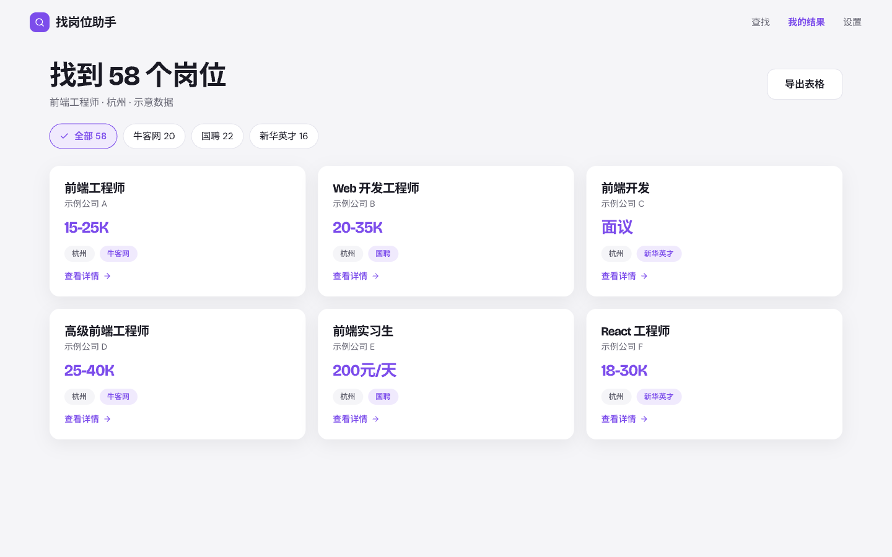

# dear-job-seeker

A **local job-search client** that speaks MCP. One process on your own machine crawls public job sites (and, optionally, sites that need your own login), keeps the results in a local SQLite file, and gives you two ways to use it:

- **MCP server (stdio)** — plug it into any MCP-capable AI client and ask for jobs in plain language.
- **Desktop app** — a small native window for people who never touch a terminal. No local web server, no open port.

> 中文简介：本地运行的找岗位客户端。AI 助手通过 MCP 调用，或直接打开桌面窗口使用；可按平台设置抓取频次与代理出口，需要登录的网站用你自己的账号在本机扫码登录，cookie 不上传。

| Search | Results |
|---|---|
|  |  |

## Download

Every [release](https://github.com/daijinma/dear-job-seeker/releases/latest) has three ready-to-run builds with Python and all libraries inside, so there is nothing to install:

| Your computer | File |
|---|---|
| Mac with Apple silicon (M1 or later) | `dear-job-seeker-<version>-macos-arm64.zip` |
| Mac with an Intel chip | `dear-job-seeker-<version>-macos-x86_64.zip` |
| Windows 10 / 11, 64-bit | `dear-job-seeker-<version>-windows-x64.zip` |

Unzip it and double-click **找岗位助手** (`找岗位助手.app` on a Mac, `找岗位助手.exe` in the unzipped folder on Windows). The same download holds the command-line program `djs` for AI clients and scripts; it uses the same data as the window.

**First launch.** The builds are not code-signed, so the system asks once whether to trust them.

- **macOS** — "cannot be opened because Apple cannot check it for malicious software". Right-click the app, choose *Open*, then *Open* again. On macOS 15 and later that shortcut is gone: open System Settings → Privacy & Security, scroll to the message about the app and click *Open Anyway*. Or run `xattr -dr com.apple.quarantine "找岗位助手.app"` once in Terminal.
- **Windows** — SmartScreen shows "Windows protected your PC": click *More info*, then *Run anyway*. The window needs Microsoft's WebView2 runtime, which comes with Windows 11 and current Windows 10 updates.

**MCP command.** Give your MCP client the `djs` program from the download:

| System | Command |
|---|---|
| macOS | `/Applications/找岗位助手.app/Contents/MacOS/djs` (wherever you put the app) |
| Windows | `C:\path\to\dear-job-seeker\djs.exe` |

```json
{"mcpServers": {"dear-job-seeker": {"command": "/Applications/找岗位助手.app/Contents/MacOS/djs"}}}
```

**Browser.** Logging in to a site (Boss) opens Google Chrome or Microsoft Edge when one is installed. With neither, run `djs install-browser` once: it downloads Chromium (several hundred MB).

## Quick start

```bash
git clone https://github.com/daijinma/dear-job-seeker.git && cd dear-job-seeker
python3 -m venv .venv
.venv/bin/pip install -e '.[ui]'            # '.[dev,ui]' to also run the tests
.venv/bin/playwright install chromium       # only needed for QR login (Boss)
```

**Desktop app**

```bash
.venv/bin/djs ui
```

## Use it from an AI client (MCP)

The MCP server is the `djs` command over stdio. Pick one way to register it:

| Where | How |
|---|---|
| Any MCP client, nothing installed (needs [uv](https://docs.astral.sh/uv/)) | `{"mcpServers": {"dear-job-seeker": {"command": "uvx", "args": ["--from", "git+https://github.com/daijinma/dear-job-seeker", "djs"]}}}` |
| Working in a clone of this repo | nothing to do: the committed [`.mcp.json`](.mcp.json) runs `uv run djs` from the repo root |
| Your own virtualenv | `{"mcpServers": {"dear-job-seeker": {"command": "/abs/path/to/.venv/bin/djs"}}}` |

Keys for the key-signed platforms go in the client's `env` block or in `$DJS_HOME/.env` (see below). Verified end to end on 2026-10-11 with a headless MCP host using the project `.mcp.json`: `provider_list → crawl_start → task_list → jobs_get → job_detail`.

Then ask: *"Find Python jobs in Hangzhou on nowcoder and zhaopin"*.

## Platforms

Each platform declares its own type and pacing; nothing is global.

| Platform | name | auth | city | interval (floor) | page cap | needs env |
|---|---|---|---|---|---|---|
| 牛客网 | `nowcoder` | public | optional | 0.6s (0.3s) | — | — |
| 国聘 | `iguopin` | public | optional | 3s (1s) | 20 | — |
| 新华英才 | `chinahr` | public | optional | 0.8s (0.5s) | — | — |
| 智联招聘 | `zhaopin` | public | optional | 3s (1.5s) | 3 | — |
| 公共招聘网 | `mohrss` | public | optional | 1s (0.5s) | — | — |
| 中智招聘 | `ciic` | public | optional | 3s (1.5s) | 20 | — |
| 字节跳动招聘 | `bytedance` | public | optional | 0.8s (0.4s) | — | — |
| 鱼泡直聘 | `yupao` | public | optional | 3s (1.5s) | 34 | `DJS_YUPAO_NONCE_KEY`, `DJS_YUPAO_SIGN_SALT` |
| 前程无忧 | `job51` | public | optional | 3s (1.5s) | 20 | `DJS_JOB51_HMAC_KEY` |
| 58同城 | `job58` | public | **required** | 1.5s (0.75s) | — | `DJS_JOB58_LUNA_SALT` |
| 赶集网 | `ganji` | public | **required** | 1.5s (0.75s) | 1 | — |
| BOSS 直聘 | `boss` | **login** | optional | 6s (4s) | 5 | — (QR login) |

- **auth** — `public` needs no account; `login` needs your own cookie, obtained by scanning a QR code in a real browser window on your machine.
- **interval (floor)** — default seconds between two requests of that platform, and the lowest value `set_frequency` accepts without `force=true`.
- Verified against the live sites on 2026-10-11: all `public` platforms returned real listings (the four "needs env" ones with keys supplied). Fixtures in `tests/` are synthetic; layouts and field names can change without notice.
- 实习僧 (shixiseng) is intentionally not included: its data needs a JavaScript evaluator.

### Platforms that need keys

Yupao, 51job and 58.com sign their requests with material extracted from their own mini-programs. **No key is shipped in this repository.** Supply them yourself as environment variables; a platform without its variables shows as "not configured" and is skipped.

```bash
# $DJS_HOME/.env  (default ~/.dear-job-seeker/.env; see .env.example; never commit it)
DJS_YUPAO_NONCE_KEY=...
DJS_YUPAO_SIGN_SALT=...
DJS_JOB51_HMAC_KEY=...
DJS_JOB58_LUNA_SALT=...
```

**`.env` autoload.** The MCP server, `djs ui` and the CLI read `$DJS_HOME/.env` and then `./.env` at start (`KEY=VALUE` lines, `#` comments, optional quotes, empty values skipped). A variable that is already set (shell, your MCP client's `env` block, or the first file) is never overridden, and values are never logged. This is what gives a desktop app started from Finder, which has no shell environment, its keys. Obtaining and using such keys is your own responsibility and may violate the platforms' terms.

### Boss (experimental)

QR login, cookie storage (0600, local only) and the list/detail calls are implemented, but Boss has been observed to answer the plain-HTTP list endpoint with `code 37` ("environment abnormal") even for valid logins. `code 37` is treated as a **block** (cooldown + retry), never as an expired login. Test it with your own account before relying on it.

## MCP tools

| Tool | Purpose |
|---|---|
| `provider_list` | every platform: label, auth, city rule, effective interval/jitter/max pages, floor, page cap, login/config state |
| `crawl_start(provider, keyword, city?, max_pages?, detail="auto")` | queue a crawl task (validates city rule and missing keys). `detail`: `auto` requests a job's detail page only while the job still lacks a required element, `always` for every job that has none stored yet, `never` keeps the list items only (**quick mode**: one request per page); `true` / `false` still mean always / never |
| `task_list(status?, limit)` | task status and stats (pages, new / seen jobs, details, **complete / incomplete**); stats update while the task runs |
| `search_list(limit=20)` | recent searches (same keyword + city = one search): aggregate status, distinct job count, per-platform status / job count / complete / incomplete / last error |
| `jobs_get(task_id?, provider?, limit, with_detail, complete_only=true)` | stored jobs; `task_id` returns every job that task saw, including ones an earlier task found first. Only **complete** jobs by default; `complete_only=false` adds the rest, each with `missing` and `incomplete_reason` |
| `job_detail(job_id)` | full text of one stored job: fetched once with the platform's own pacing and exit, its fields derived again from it, then served from the database |
| `login(provider)` | open the platform's login page in a browser window (blocks up to 180 s); the window closes by itself once the login is detected, the session is saved locally with its expiry, and tasks waiting for it resume. One flow for every platform that has a login (`optional` or `login`) |
| `login_status(provider?)` / `login_check(provider?)` / `logout(provider)` | `login_status`: `logged_in` / `expired` / `not_logged_in`, when it was saved and when it ends, how to log in and what it improves, for one platform or all that have a login (saved files only). `login_check` asks the platform once (an HTTP probe) and marks a dead login expired; the same check runs in the background at startup. `logout` deletes the saved login |
| `set_frequency(provider, interval?, jitter?, max_pages?, force?)` | per-platform override; below the floor needs `force=true` |
| `egress_add(url, provider="*")` / `egress_remove(url)` / `egress_list` | proxy pool (`direct` or `http(s)://…`; passwords are masked in output) |

Errors come back as `{"error": "..."}`; tools never raise.

## Data completeness

A stored job is final only when none of its required elements is missing.

| Element | Columns | Rule |
|---|---|---|
| position | `title` | non-empty |
| company | `company` | non-empty |
| city | `city` (+ `district` when known) | non-empty |
| salary | `salary_min`, `salary_max`, `salary_unit`, `salary_months` | two whole numbers, never text. `salary_unit` is `元/月`, `元/天`, `元/时` or `元/年`; `salary_months` the paid months when stated (`·14薪` → 14, never multiplied in). Taken from a platform's numeric fields where it states the unit (nowcoder, iguopin, mohrss), otherwise parsed from its salary text (`15-25K·14薪`, `1-1.5万`, `8千-1.8万`, `20-30万/年`, `200-400元/天`, `100元/时`). 面议 has no numbers, so the job stays incomplete |
| JD | `description` | plain text (HTML tags stripped, line breaks kept) |

Stored when the site has them, not required: `education`, `experience`, `salary_text` (as the site words it), `source_url`, `published_at`.

**How records get completed.** A crawl stores the list pages first, so results appear at once, then makes a second pass: with `detail="auto"` a job's detail page is requested only if the job still lacks a required element (zhaopin, yupao, nowcoder, iguopin, mohrss and bytedance carry the JD in the list, so they need no detail request at all). A later search over the same jobs completes the ones an earlier quick search left open. Every job carries `missing` (the absent elements), `complete`, and in tool output an `incomplete_reason`: `面议`, `需登录才能看到薪资`, `详情获取失败` or `平台未提供…`.

**What the sites do not publish** (those jobs stay incomplete and say why): ByteDance gives no salary at all; Boss hides the salary until you log in; 国聘, 新华英才, 58同城 and 赶集 word some salaries as 面议. 公共招聘网 publishes education and experience only as opaque codes, which are not mapped.

## How it works


- **Queue** — SQLite tasks, claimed atomically; `pending → running → done | retry (backoff) | dead after 8 | waiting_login`. One worker thread **per platform** runs inside the process, so platforms never queue behind each other; unfinished tasks continue on the next start.
- **Frequency** — effective value = your override, else the platform default, never below its floor unless forced. Spacing is enforced per *(platform, exit)* across threads and processes before every request.
- **Egress** — a platform-specific proxy beats the shared pool; the exit is sticky per task; blocked exits cool down 30 min (3 consecutive failures: 5 min). An empty pool means direct. Login platforms use direct unless you add a dedicated proxy for them (a foreign IP with your personal cookie is more likely to be flagged).
- **Dedupe** — `UNIQUE(provider, source_job_id)`; re-crawls update `last_seen_at`. The `task_jobs` table links every task to every job it saw, so repeating a search shows its results even though the jobs were found earlier.
- Design docs: [`docs/plan/v1.1.0/prd.md`](docs/plan/v1.1.0/prd.md), [`docs/architecture.drawio`](docs/architecture.drawio), UI/logic mockups in [`docs/design/`](docs/design/).

## CLI

For scripts, cron and agents that do not speak MCP. Both commands load `.env` like the server does.

| Command | What it does |
|---|---|
| `djs call <tool> ['<json args>']` | run any MCP tool by name, print its JSON result on stdout; errors are `{"error": "..."}` with exit code 1 (an unknown tool lists the available ones) |
| `djs work [--until-idle] [--timeout SEC]` | run the per-platform workers in the foreground and print one line per finished task (`task 3 nowcoder done pages=1 new=20 seen=0`). `--until-idle` exits once nothing is queued or running (tasks waiting for a login do not count; a failing task is retried with growing back-off, so pair it with `--timeout`); `--timeout` stops after SEC seconds (exit 2 if `--until-idle` was not reached) |

```bash
djs call crawl_start '{"provider":"nowcoder","keyword":"python","max_pages":1,"detail":"never"}' \
  && djs work --until-idle --timeout 120 \
  && djs call jobs_get '{"task_id":1,"limit":3}'
djs call job_detail '{"job_id":7}'      # full text on demand
djs call search_list
```

`djs` with no arguments is still the stdio MCP server and `djs ui` the desktop app; both run the workers themselves. `djs call` only reads and writes the database, so queued tasks wait until some process runs the workers: the MCP server, the desktop app or `djs work`.

## Desktop app

`djs ui` opens a native window (pywebview). The page talks to Python through an in-process bridge — there is no HTTP server and nothing listens on a port. Screens: search (the newest search sits right under the box), results (complete jobs by default with a switch for the rest, sorted across sites or by salary, CSV export into the Downloads folder), platform logins (state of every login with a badge in the top bar), settings (speed: steady / standard / fast, optional proxy). Without pywebview, `djs ui` prints the install hint.

## Data and privacy

Everything lives in `$DJS_HOME` (default `~/.dear-job-seeker`): `djs.db` (SQLite), `.env` (optional keys, see above), `profiles/<platform>/` (cookies 0600, browser profile), `pace/` (rate-limit locks), `ui_prefs.json`. Cookie values are never written to the database, logs, tool results or error messages.

## Development

```bash
.venv/bin/pip install -e '.[dev,ui]'
.venv/bin/python -m pytest -q          # no network, no browser, no window
```

Layout: `djs/{db,taskqueue,pacer,egress,engine,service}.py` (core), `djs/jobs.py` (the jobs table: one derivation of every column, the completeness verdict), `djs/normalize.py` (the data contract: salary parsing, plain-text JD, missing elements), `djs/server.py` (MCP tools, thin wrappers over `service`), `djs/cli.py` (`call` / `work`), `djs/envfile.py` (`.env` autoload), `djs/providers/` (one file per platform; contract in `base.py`), `djs/ui_app.py` + `djs/ui_api.py` + `djs/ui/` (desktop app).

## Compliance

Only crawl what you are allowed to, at low rates, from your own network; respect each site's terms and robots rules. Using a personal account for automated access (Boss) can get that account restricted. The authors accept no liability for how this tool is used.

## Build from source

The downloads are built with [PyInstaller](https://pyinstaller.org) from [`packaging/dear-job-seeker.spec`](packaging/dear-job-seeker.spec): one folder with the window program `找岗位助手` and the console program `djs`, sharing one Python runtime (macOS: `找岗位助手.app`, with `djs` in `Contents/MacOS`). Build on the system you build for, with Python 3.12 (what CI uses):

```bash
python3.12 -m venv .venv-build
.venv-build/bin/pip install -e '.[ui,packaging]'                         # Windows: .venv-build\Scripts\pip
.venv-build/bin/pyinstaller --noconfirm packaging/dear-job-seeker.spec   # result in dist/
PATH="$PWD/.venv-build/bin:$PATH" packaging/smoke.sh dist                # Windows: python packaging/smoke.py dist
```

`packaging/smoke.sh` is the check CI runs on every build: `--selftest` of both programs, `djs call provider_list`, one real crawl (needs network), an MCP session over stdio and, on macOS, opening the app for 8 seconds (`--no-launch` skips that, e.g. on a locked desktop). A release zips the result as `dear-job-seeker-<version>-macos-arm64.zip`, `…-macos-x86_64.zip` (both with `ditto -c -k --keepParent dist/找岗位助手.app <zip>`) and `…-windows-x64.zip` (the `dist/dear-job-seeker` folder). Pushing a tag `vX.Y.Z` that equals the version in `pyproject.toml` runs [`.github/workflows/release.yml`](.github/workflows/release.yml), which builds all three and attaches them to that release; a manual run only keeps them as workflow artifacts. On an Intel Mac install `"cryptography<49"` before the project: newer releases ship no Intel wheels.
